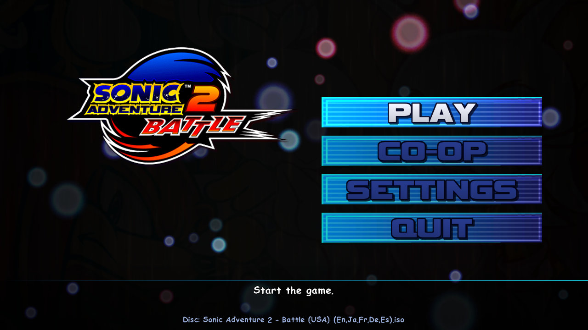
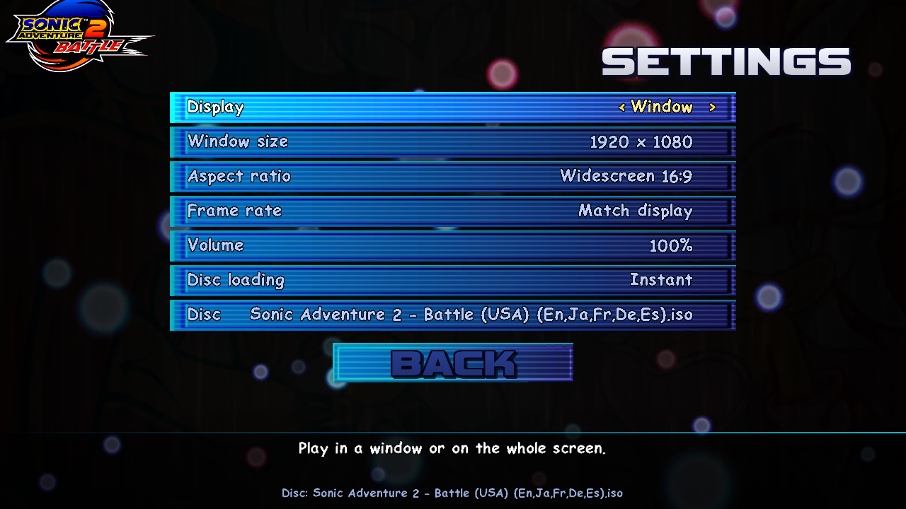
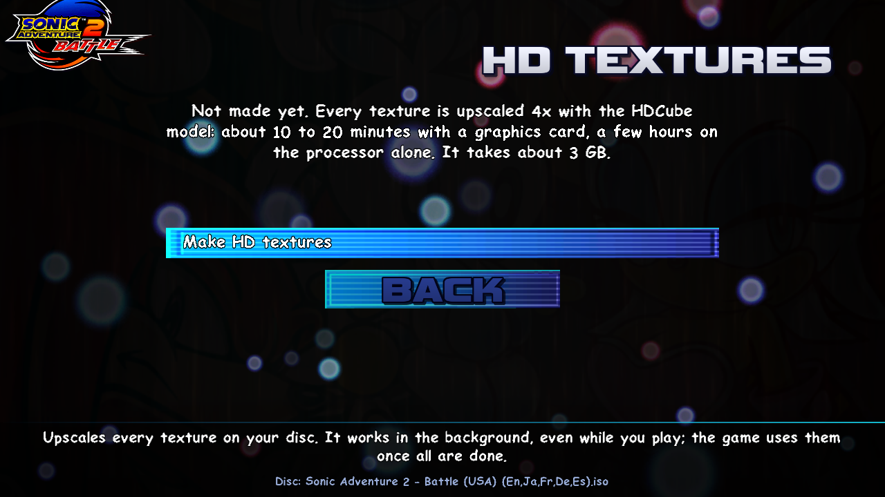
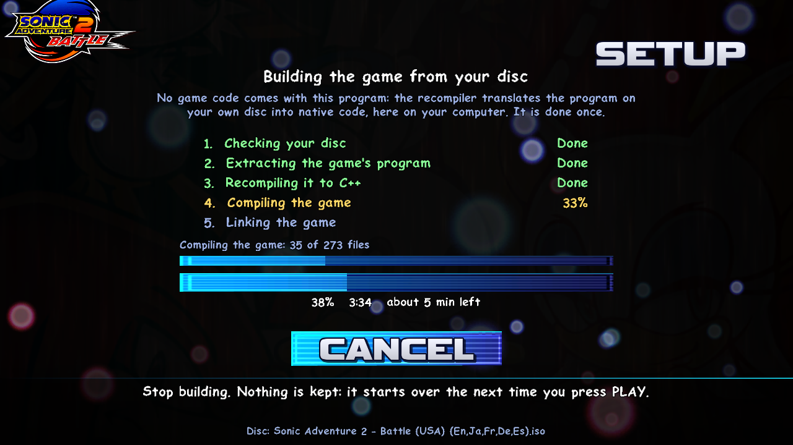

# Sonic Adventure 2 Battle: Recompiled

A native PC version of **Sonic Adventure 2: Battle** (GameCube, USA), made by static recompilation:
the game's PowerPC code is translated to C++ ahead of time and runs natively, with its own runtime in
place of the console's hardware. No emulator.

**Nothing of the game is included: neither its data nor its code, translated or not.** You need your
own copy of the game (USA disc image, `GSNE8P`). The first time you press PLAY, the launcher builds
the game's code from your disc, on your computer, with the recompiler and a bundled compiler
([docs/SETUP.md](docs/SETUP.md)); the game reads everything else from the disc as it plays.



<p>
  
  
</p>

The launcher is drawn with the game's own menu art, lights and message font, read from your disc.

## Features

- Story, stage select, Chao World, kart races, bosses, 2P battle and memory card saves
- Widescreen at any aspect ratio (16:9, 16:10, ultrawide, resizable windows), HUD kept at the edges
- Smooth motion on 120/144 Hz displays (in-between frames), the game itself at its 60 Hz
- Optional **HD textures**: every texture on your disc upscaled 4x with the HDcube model, made on
  your own computer from the launcher
- Original disc loading times by default (cutscenes are timed for them), or instant loading
- A launcher in the game's own style: drawn with the menu art, lights and font from your disc

## Playing

1. Download the latest release and unpack it in a folder of your own (not Program Files).
2. Run **SA2BLauncher.exe**, choose **CHOOSE DISC** and pick your disc image (`.iso`/`.gcm`).
3. **PLAY**. The first time, the **SETUP** page builds the game from your disc, once: about 10
   minutes with 8 processor threads, 20 or more with 4, and about 1 GB of free space while it works.
   It shows each step with its progress, and the whole build's with the time left; then the game
   starts.
4. **SETTINGS** for display, frame rate, volume and loading.

Controls: a gamepad works directly. Keyboard: WASD stick, Space A, Shift B, F X, C Y, Enter START,
Q/E L/R, IJKL C-stick, arrows D-pad. F11 toggles full screen.

Saves go to `saves/MemoryCardA.raw` next to the program (a GameCube memory card image, the same
format as Dolphin's).

### Setup: building the game from your disc

| Step | What happens |
|---|---|
| 1. Checking your disc | The whole image's SHA-1, compared with the known dump (below) |
| 2. Extracting the game's program | `main.dol` and all 95 code modules, read from the image; the Chao World's PRS-compressed ones unpacked |
| 3. Recompiling it to C++ | The recompiler, built into the launcher, finds every function and translates the PowerPC code: about 270 MB of C++ |
| 4. Compiling the game | The bundled clang (LLVM 19.1.5) compiles it, one file per processor thread |
| 5. Linking the game | The bundled lld-link makes `sa2b_game.dll`, which `sa2b.exe` loads |



The work files go to `%LOCALAPPDATA%\SA2BRecompiled\build` and are removed afterwards; the result is
`sa2b_game.dll` (about 290 MB) next to `sa2b.exe`, and `setup.log` says what happened. It runs
again only after an update of the program or when you choose another disc image. All the details
- the compiler and linker command lines, the freestanding module, how the runtime and the module
fit together - are in [docs/SETUP.md](docs/SETUP.md).

### Your disc image

The setup checks it, so you don't have to. It is made for the Redump dump of the USA disc:

| | |
|---|---|
| Size | 1,459,978,240 bytes |
| CRC32 | `024f4f8f` |
| MD5 | `9ef5fadf4b8756af820df997468a5a16` |
| SHA-1 | `f8cc51128df2a3b0da9d6f3a234c895a4cd7dc22` |

To check yours: `Get-FileHash -Algorithm SHA1 "<disc image>"` in PowerShell. An image that is not a
1:1 copy (trimmed, another dump tool) is accepted too when the game's program on it is identical
(SHA-1 of the extracted program: `e23d2e3b41d2b051b3360fb1b55f9af6a96d6c37`); another version of the
game (Europe, Japan) is not.

### HD textures

On the launcher's **HD TEXTURES** page: **Install the upscaler** (a private copy of Python and
PyTorch, and the HDcube model from its author's release page, about 3 GB with an NVIDIA card), then
**Make HD textures**. It takes about 10-20 minutes with a graphics card, longer on the processor
alone, and can run while you play; the game uses the textures once all are done.

## Building from source

Windows, Visual Studio 2022 (clang-cl), CMake and Ninja, Python 3.

```
git clone --recursive https://github.com/sonsegajp/Sonic-Adventure-2-Battle-Recompiled
python tools/extract.py "<your disc image>"          # orig/: main.dol and the REL modules
build/windows-clang/sa2recompile.exe --dol orig/main.dol --rels orig/rel --names config/GSNE8P/names.txt --patches config/GSNE8P/patchpoints.txt --out build/gen
powershell -File tools/build.ps1                     # sa2b.exe, sa2b_game.dll and SA2BLauncher.exe
```

(`tools/build.ps1 -Target sa2recompile` first builds the recompiler.) The developer build compiles
`build/gen` into `sa2b_game.dll` itself (the `sa2b_game` target, with the same freestanding flags
the launcher's setup uses). Optionally, `python tools/launcher/mkicon.py --disc "<disc image>"`
gives the programs the game's own icon.

A release (`tools/package.ps1`) never contains `sa2b_game.dll`: it bundles `clang.exe` and
`lld-link.exe` from the official LLVM 19.1.5 release instead (put them in `build/llvm` first), and
the launcher builds the module on the player's computer.

How it works: [docs/PLAN.md](docs/PLAN.md). In short, `src/recompiler` finds every function in
`main.dol` and the 95 code modules and emits C++; `src/runtime` provides the console (CPU state,
interrupts, threads, DVD, audio DSP, memory card, video) and hands the game's GX command stream to
[Aurora](https://github.com/encounter/aurora) (WebGPU) for drawing.

## Credits and licences

- This project's code: [PolyForm Noncommercial 1.0.0](LICENSE.md).
- [Aurora](https://github.com/encounter/aurora) (MIT), with local changes in `patches/aurora`.
- SDL3, Dawn, libpng, zlib, xxHash: see `THIRD_PARTY_NOTICES.txt` in a release.
- [LLVM](https://llvm.org) 19.1.5's clang and lld (Apache 2.0 with LLVM Exceptions), bundled
  unchanged for the setup.
- [HDcube](https://github.com/Venomalia/HDcube) by Venomalia: downloaded from its author by the
  upscaler setup, never redistributed here.
- The launcher's button lettering is rendered from Vipnagorgialla by Typodermic Fonts (words as
  images; the font itself is not included).

Sonic Adventure 2: Battle is © SEGA. This project is not affiliated with or endorsed by SEGA or
Nintendo. Please buy the game.
